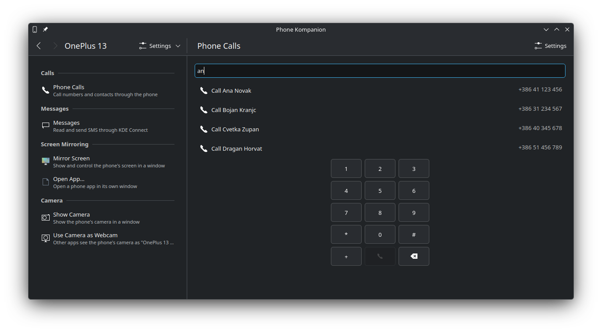
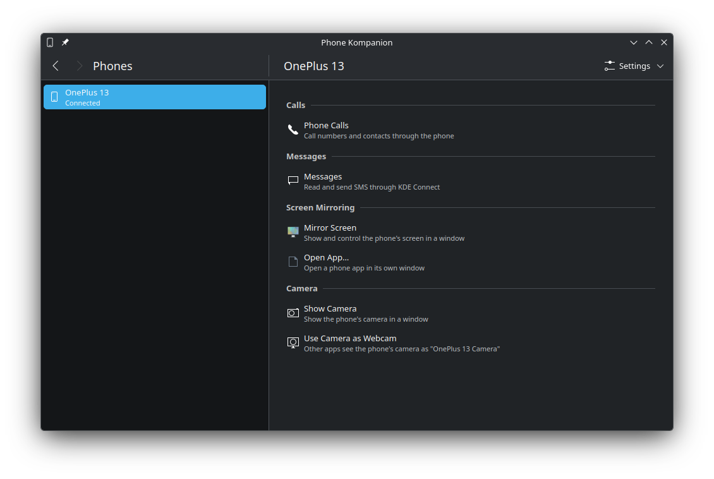
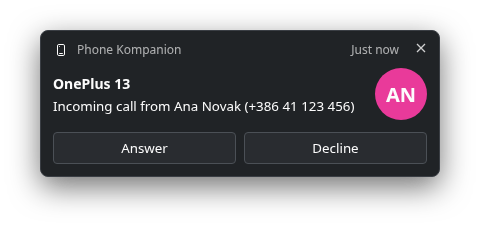
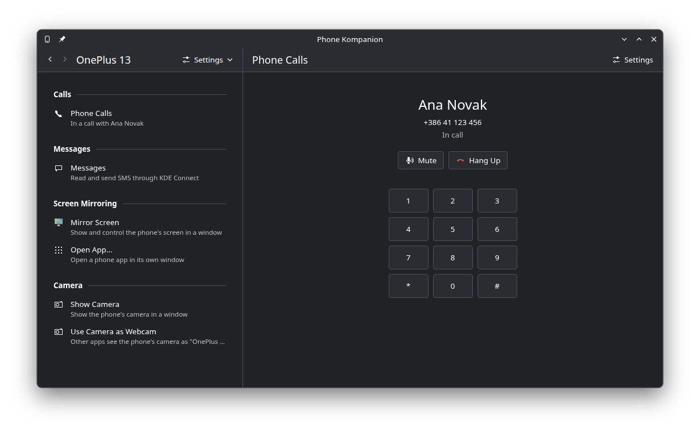
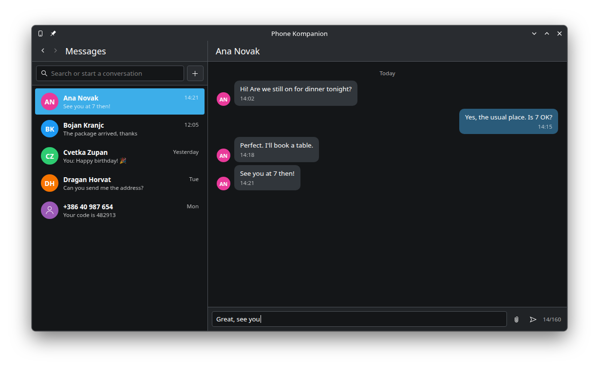
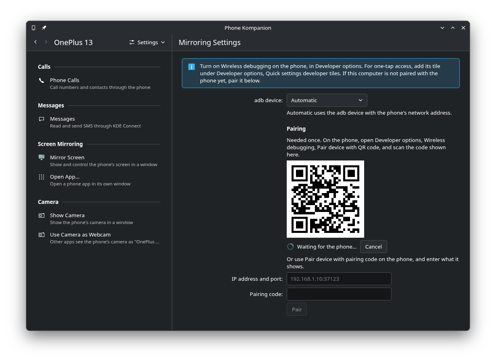
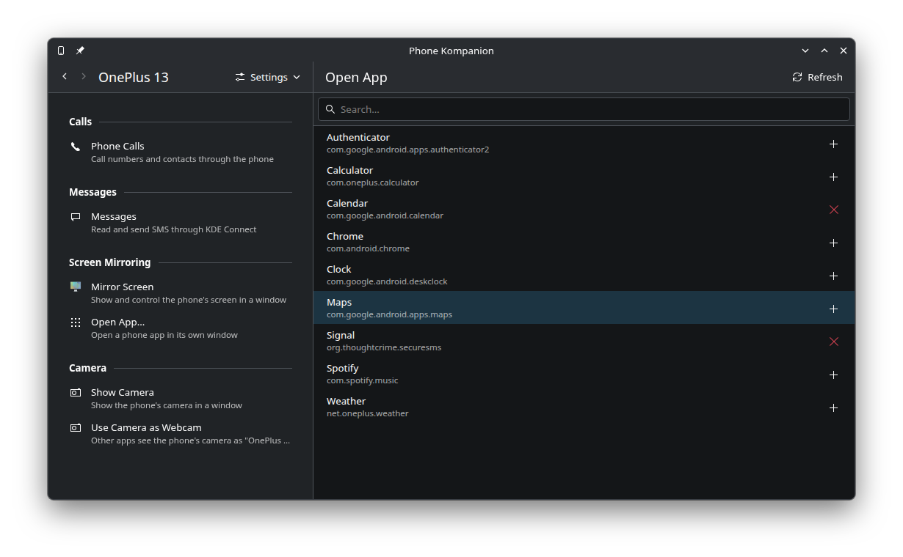
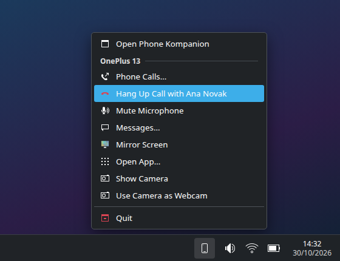
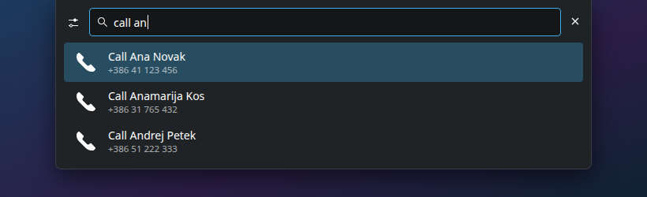

<!--
SPDX-FileCopyrightText: 2026 Rok Krajnc <rok.krajnc@gmail.com>
SPDX-License-Identifier: CC0-1.0
-->

# Phone Kompanion

<p class="tagline">Phone calls, the phone's screen, apps and camera, and SMS on the KDE Plasma desktop.</p>



Phone Kompanion works with the phones you have paired in [KDE Connect](https://kdeconnect.kde.org/)
and adds what KDE Connect does not do by itself:

- **Calls over Bluetooth**: answer, make and hang up phone calls on the computer, with the call
  audio on the computer's speakers and microphone.
- **Messages**: read and send SMS in the same window.
- **The phone's screen and apps**: mirror the phone's screen, or open a single phone app in its
  own window, with [scrcpy](https://github.com/Genymobile/scrcpy).
- **The phone's camera**: show it in a window, or use it as a webcam in video calls.

It runs next to the KDE Connect from your distribution; there is nothing to replace.

## Installing

Packages for openSUSE Tumbleweed and Leap 16, Fedora 44, Debian 13 and Ubuntu 26.10 are built on
the openSUSE Build Service:
[install instructions](https://software.opensuse.org/download.html?project=home:rkrajnc11&package=phonekompanion).
On Fedora, scrcpy comes from COPR; on Debian 13, from trixie-backports.

You need:

| For | You need |
|---|---|
| Everything | KDE Plasma 6, and KDE Connect with the phone paired |
| Calls | The phone paired over Bluetooth, BlueZ, and PipeWire with WirePlumber (1.6 tested) |
| Mirroring, apps and camera | `scrcpy` and `adb` (android-tools), and Wireless debugging on the phone |
| Webcam | The `v4l2loopback` kernel module |

To build it yourself, see [Building](https://github.com/rkrajnc/phonekompanion#building) in the
README.

## Getting started

1. **Pair the phone in KDE Connect**, if you have not already.
2. **Pair the phone over Bluetooth** in System Settings, Bluetooth. This is what carries the calls.
3. **Start Phone Kompanion** from the application menu. Its background service starts with each
   login from then on, with an icon in the system tray.
4. **Pick your phone** in the list on the left. Its page has everything Phone Kompanion can do
   with it.



Each entry on the phone's page says in its subtitle what is missing when it can't be used, such as
"Not connected over Bluetooth". The **Settings** menu at the top has the settings for calls and for
screen mirroring.

## Calls

### Answering

An incoming call shows a notification on the computer, with the caller's name from your contacts.



- **Answer** takes the call on the computer: you talk through the computer's speakers and
  microphone, and the phone works as a Bluetooth headset gateway.
- **Decline** rejects the call.
- If you answer on the phone instead, the call stays on the phone. **Move Audio to PC** in the
  notification or the dialer brings it over.

During a call the notification stays open with **Mute Microphone** and **Hang Up**.

A call you did not take leaves a **missed call** notification, with **Call Back**.

### Making a call

Open **Phone Calls** on the phone's page. Type a name to search the contacts that KDE Connect
syncs from the phone, or type a number, and click the contact or the call button. <kbd>Enter</kbd>
calls the number, or the contact when only one matches.

During a call the dialer shows the caller, **Mute**, **Hang Up**, and the number pad, which then
sends tones, for menus such as "press 1 for ...".



You can also call:

- from **KRunner** (<kbd>Alt</kbd>+<kbd>Space</kbd>): type `call` and a name or a number,
- from the **tray icon** menu, **Phone Calls…**,
- by clicking a **`tel:` link** in a browser or another app (see [Links](#tel-and-sms-links)),
- from a script: `phonekompanion-cli --call "Ana"`.

### Call settings

**Settings, Calls** on the phone's page:

- **Bluetooth phone**: the Bluetooth device that carries the calls. *Automatic* uses the paired
  Bluetooth phone with the same name as in KDE Connect.
- **Use this computer for calls**: when off, the computer only shows incoming and missed calls,
  and the audio stays on the phone. Useful on a second computer.
- **Connect for calls automatically**: connects the phone over Bluetooth as soon as it shows up in
  KDE Connect.

> KDE Connect also shows incoming and missed calls, so you may see each call twice. To see each
> call once, turn off KDE Connect's "Incoming call" and "Missed call" notifications. The call
> settings have a button that opens them.

## Messages

**Messages** on the phone's page shows the SMS conversations that KDE Connect syncs from the phone.
Pick one to read it and reply; **+** starts a new conversation. You can attach images.



These are KDE Connect's own SMS pages, built into the window, so they work the same as in KDE
Connect's SMS app.

## Screen mirroring and apps

Mirroring uses scrcpy over the phone's **Wireless debugging**, so the phone and the computer need
to be on the same network. No cable needed.

### Pairing, once

1. On the phone, turn on **Developer options**: in Settings, About phone, tap **Build number**
   seven times.
2. In Developer options, turn on **Wireless debugging**.
3. In Phone Kompanion, open **Settings, Screen Mirroring** and click **Show QR Code**.
4. On the phone, tap **Pair device with QR code** under Wireless debugging and scan the code.



If scanning does not work, use **Pair device with pairing code** on the phone and enter the address
and code it shows into the fields below the QR code.

> Wireless debugging turns itself off now and then, for example on another Wi-Fi network. For
> one-tap access, add its tile under Developer options, **Quick settings developer tiles**.

### Mirror the screen

**Mirror Screen** opens the phone's screen in a window. Use the mouse and the keyboard as on the
phone. By default the phone's sound plays on the computer and the phone's own screen turns off.

### Open a single app

**Open App…** lists the apps on the phone. Click one to open it in its own window, next to your
other windows, on a virtual display of the phone; the phone's own screen stays free.



**+** next to an app adds it to the application menu of the computer, so you can start it like any
other app, and pin it to the task manager. **×** removes it again.

KRunner opens apps too: type `phone` and the app's name.

### Mirroring settings

| Setting | What it does |
|---|---|
| Play the phone's sound on this computer | Sound from mirrored screens and apps plays on the computer |
| Turn the phone's screen off while mirroring | Saves the battery; the mirror keeps working |
| Keyboard | *Physical keyboard* uses the phone's keyboard layout, for languages with special letters |
| App windows | *Like the phone screen*, or a *Resizable* window whose size the app follows |
| App density | With resizable app windows, a higher number makes text and buttons larger |
| Extra scrcpy options | Passed on to scrcpy, for example `--max-size=1920` |

## Camera and webcam

**Show Camera** opens the phone's back camera in a window. The camera and its rotation are in the
mirroring settings.

**Use Camera as Webcam** makes the phone's camera a webcam for other apps, such as video calls in
the browser. It needs the `v4l2loopback` kernel module, which your distribution packages. To load
it:

```
sudo modprobe v4l2loopback exclusive_caps=1 card_label="Phone Camera"
```

Other apps then see a camera called "Phone Camera". To load it at every boot:

```
echo v4l2loopback | sudo tee /etc/modules-load.d/v4l2loopback.conf
echo 'options v4l2loopback exclusive_caps=1 card_label="Phone Camera"' | sudo tee /etc/modprobe.d/v4l2loopback.conf
```

While the webcam is on, a notification says so, with **Stop**.

## Everywhere on the desktop

### Tray icon

The tray icon's menu has each connected phone's calls, messages, mirroring and camera. During a
call it also has **Hang Up** and **Mute Microphone**. Clicking the icon opens the window.



### KRunner

| Type | To |
|---|---|
| `call ana` | Call a contact |
| `call +386 41 123 456` | Call a number |
| `phone signal` | Open the phone's Signal app in a window |
| `phone screen` | Mirror the phone's screen |
| `phone camera` | Show the phone's camera |



### `tel:` and `sms:` links

Phone Kompanion can open `tel:` links in the dialer and `sms:` links in a conversation, with the
number and text filled in, also from browsers. To make it the handler for them:

```
xdg-mime default io.github.rkrajnc.phonekompanion.dialer.desktop x-scheme-handler/tel
xdg-mime default io.github.rkrajnc.phonekompanion.messages.desktop x-scheme-handler/sms
```

## Command line

`phonekompanion-cli` does what the window does, for scripts and keyboard shortcuts:

```
phonekompanion-cli --list-phones
phonekompanion-cli --call "Ana"               # or a number
phonekompanion-cli --mirror
phonekompanion-cli --list-apps
phonekompanion-cli --open-app org.example.app
phonekompanion-cli --camera [--camera-facing front]
phonekompanion-cli --webcam | --stop-webcam
```

With more than one phone, choose one with `--phone <id or name>`. With `--notify`, errors also show
as a notification, for shortcuts that have no terminal.

The window takes `--phone <id>`, `--dialer`, `--messages` and `--apps`, so a shortcut can open it
on a given page.

## Troubleshooting

**Phone Calls says "Not connected over Bluetooth".**
Check that the phone is paired and connected in System Settings, Bluetooth, and that **Use this
computer for calls** is on in the call settings.

**Phone Calls says "Needs PipeWire with telephony support".**
Calls need PipeWire's telephony API, `org.pipewire.Telephony`, which WirePlumber provides in recent
PipeWire versions (1.6 is tested). Update PipeWire, or check that WirePlumber is running:
`systemctl --user status wireplumber`.

**Mirroring says the phone "is not on the same network".**
The phone and the computer must be on the same network, and the network must allow devices to reach
each other. Guest Wi-Fi networks often don't.

**Mirroring says scrcpy or adb is not installed.**
Install `scrcpy` and `android-tools`. On openSUSE, also run `sudo scrcpy-update-server` once.

**Each call shows two notifications.**
One is from KDE Connect. Turn off its call notifications, see [Call settings](#call-settings).

### Known limitations

- Muting the phone's ringer from the computer is not possible: KDE Connect does not offer it to
  other apps.
- Without Bluetooth, incoming calls are shown from KDE Connect's information, which does not say
  when the call is answered or ends; the notification closes by itself.
- Clicking KDE Connect's own SMS notifications opens KDE Connect's SMS app, not Phone Kompanion.
- The window is made for the desktop; it has not been tried on Plasma Mobile.

Found a bug? [Open an issue](https://github.com/rkrajnc/phonekompanion/issues).
